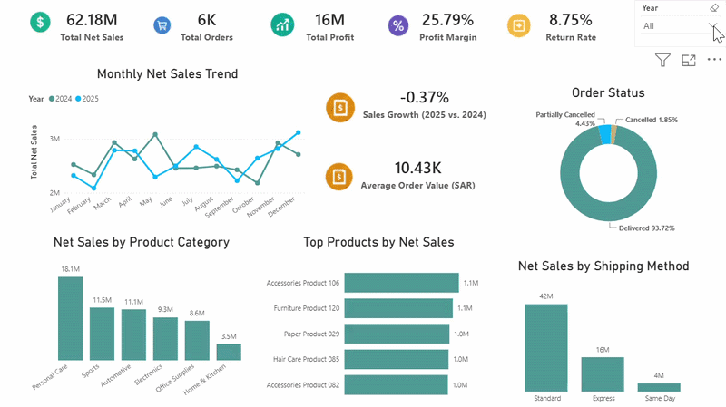

# Data Analytics Portfolio

A collection of data analytics projects using **Python, Excel, Power BI, Power Query, DAX, and data visualization**.

Each project covers different parts of the data analysis process, including data cleaning, validation, analysis, KPI development, visualization, dashboards, and business insights.

---

# Projects

## 1. Saudi Government Revenues and Expenditures Analysis (2016–2025)

**Tools:** Python · Pandas · Matplotlib

Analysis of Saudi Arabia's government revenues and expenditures from 2016 to 2025, focusing on fiscal performance, oil and non-oil revenues, budget balance, and government spending priorities.

### Key Findings

- 2022 was the only year with a budget surplus during the analyzed period.
- Oil revenues remained the largest revenue source but showed greater volatility.
- Non-oil revenues showed steadier growth over time.
- Military, education, and health and social development were among the largest expenditure areas.

### Analysis Includes

- Government Revenues vs. Expenditures
- Budget Deficit / Surplus
- Oil vs. Non-oil Revenues
- Revenue Composition
- Government Expenditure by Sector

[**View Full Project →**](Saudi%20Government%20Revenues%20and%20Expenditures%20Analysis%20%282016%E2%80%932025%29)

---

## 2. Supply Chain Performance Dashboard

**Tools:** Power BI · Power Query · DAX · Data Modeling · Data Validation

An interactive Power BI dashboard analyzing sales, profitability, delivery performance, suppliers, warehouses, stockouts, and returns.

### Key Results

- **Net Sales:** SAR 62.18M
- **Profit:** SAR 16.04M
- **Profit Margin:** 25.79%
- **Total Orders:** 5,960
- **Return Rate:** 8.75%
- **Stockout Rate:** 8.76%
- **On-Time Delivery:** 74.80%
- **Late Delivery:** 25.20%

### Key Findings

- Personal Care generated the highest sales and profit.
- The Western region generated the highest profit.
- Suppliers 19, 05, and 11 had the highest late-delivery rates.
- 25.20% of delivered orders arrived late.
- Supplier standard lead time did not strongly explain late-delivery performance.
- Discounts showed a weak negative relationship with net sales and profit margin.

[**View Full Project →**](Supply-Chain-Power-BI)

---

## 3. Retail Sales Performance Analysis

**Tools:** Excel · Power Query · Power Pivot · DAX · Pivot Tables · Pivot Charts

An Excel-based retail sales analysis using 2024–2025 transaction data, focusing on sales growth, profitability, products, sales channels, promotions, returns, and customer segments.

### Key Findings

- Net Sales increased by **3.36%**.
- Profit increased by only **1.13%**.
- Profit Margin declined from **27.46% to 26.87%**.
- Corporate Sales generated approximately **8.26M SAR** in Net Sales.
- Retail Store achieved the highest Profit Margin at **31.42%**.
- Footwear Return Rate increased from **8.79% to 14.57%**.
- Ramadan Savings generated the highest promotional sales.

### Analysis Includes

- Sales Growth
- Profitability
- Product Performance
- Sales Channels
- Promotions
- Returns
- Customer Segments
- Sales Representatives

[**View Full Project →**](Retail%20Sales%20Performance%20Analysis)

---

## 4. HR Analytics

**Tools:** PostgreSQL · SQL · Power BI · DAX

An HR analytics project analyzing employee data, workforce distribution, compensation, and employee turnover. The project includes data quality validation, salary standardization across currencies, and an interactive two-page dashboard.

### Key Findings

- The dataset contains **4,968 employees**, including 3,113 active and 1,855 inactive employees.
- Technology was the largest department, with **1,915 employees**.
- NYC had the highest employee count, with **1,796 employees**.
- Average standardized salary was approximately **USD 74.42K**.
- **85.04% of employees** were below the reference compensation level.
- Technology had the highest average department salary at approximately **USD 88K**.

### Analysis Includes

- Workforce Distribution
- Employee Status
- Compensation Analysis
- Currency Standardization
- Salary Comparison
- Employee Turnover
- Department and Office Performance
- Data Quality & Validation

[**View Full Project →**](HR%20Analytics)

---

## 5. Retail Sales & Customer Behavior Analysis

**Tools:** SQL Server · Power BI · DAX · Data Modeling

An end-to-end retail analytics project using 2025–2026 transaction data to analyze sales performance, customer purchasing behavior, RFM customer segmentation, and product performance.

The analysis covers **16,500 transactions, 1,400 customers, and 220 products** across nine retail stores.

### Key Findings

- Completed transactions generated approximately **SAR 1.50M** in revenue.
- Average Basket Value was **SAR 94.84**.
- In-store sales contributed **80.6% of revenue**, compared to 19.4% from online sales.
- Identified **414 at-risk customers** and **379 inactive customers** using purchase recency.
- Baby Care was the highest revenue-generating category, contributing approximately **SAR 314K (20.98%)** of completed sales.
- Product rankings differed between revenue and sales volume, highlighting the importance of evaluating both metrics.

### Analysis Includes

- Data Exploration & Quality Checks
- Sales Performance
- Revenue Trends
- Sales Channel Analysis
- Customer Purchase Frequency
- Customer Spending & Recency
- RFM Customer Segmentation
- Product & Category Performance
- Interactive Dashboard Development

[**View Full Project →**](Retail%20Sales%20%26%20Customer%20Behavior%20Analysis)

---
